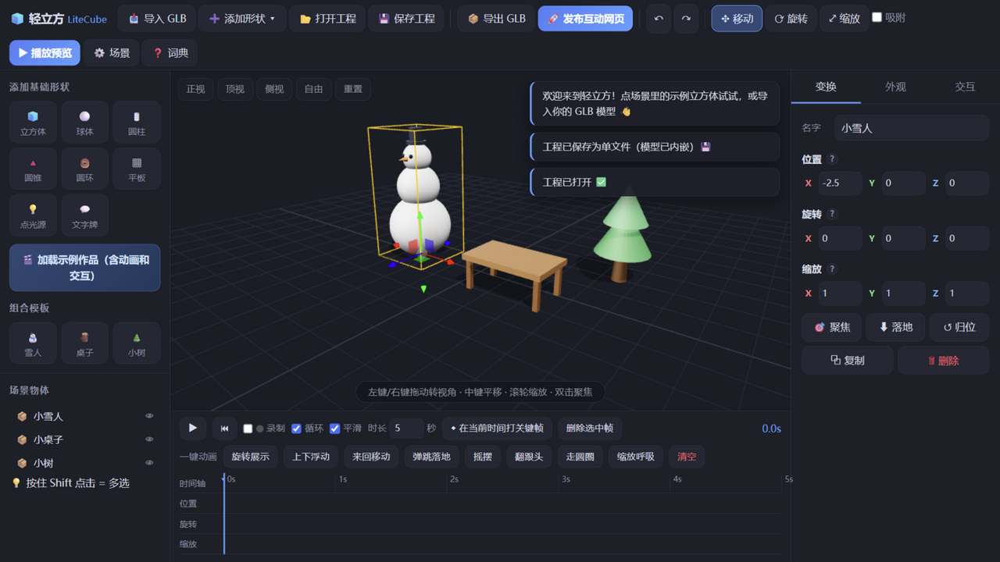

# 🧊 轻立方 LiteCube v3.1.3

> **会做 PPT，就会做 3D。** 一款为普通人设计的网页 3D 编辑器：
> 导入 GLB 模型 → 装扮材质 → 做动画 → 加点击交互 → **一键发布成网页文件**。

> 版本：v3.1.3（经 50+ 批迭代、135+ 项浏览器端到端回归测试）

## ✨ v2.0 完整能力清单

- **放进来的方式**：GLB/GLTF（含 Draco 压缩）/OBJ+MTL/点光源/文字牌/6 款组合模板/**5 款场景级模板**/⭐收藏区（含用户自定义收藏）
- **装扮**：5 种材质预设、4 种内置贴图、图片贴图、格式刷、点光源调色、场景背景预设
- **动起来**：8 种一键动画、关键帧+录制+曲线视图、三档缓动+逐关键帧缓动、帧检查器、**🎬 录视频导出 WebM（含音效）**
- **活起来**：4 事件 × 9 动作的中文规则卡片（含音效/网页跳转/抖动/相机飞行）
- **发出去**：🚀 一键发布单文件互动网页（自定义作品名/作者链接/做同款按钮/WebGL 回退/手机适配）、📦 含动画 GLB、💾 单文件工程
- **体验守护**：多选批量、右键操作体系、撤销重做、新手引导、3D 词典、防丢失提醒、全量回归套件

## 快速开始

**方式一（最快）**：浏览器打开 **[https://litecube.netlify.app](https://litecube.netlify.app/)** —— 免安装，打开即体验最新版。

**方式二（推荐·离线可用）**：双击 `启动编辑器.bat` —— 自动起本地服务并打开浏览器，离线可用。

**方式三**：直接双击 `app/index.html`（需联网，3D 引擎从 CDN 加载）。

> 导出的「互动网页」和发布的页面同样双击即可打开（需联网加载引擎）。

## 它能做什么

| 五步动线 | 功能 |
|---|---|
| 1️⃣ 放进来 | 导入 **GLB/GLTF（含 Draco）/OBJ+MTL**（拖拽也行），或添加基础形状/**点光源/文字牌**、**6 款组合模板**、**⭐ 收藏模型**（含小东京示例）；自动落地、自动调尺寸；**🎬 一键加载示例作品** |
| 2️⃣ 换装扮 | 颜色、**金属/塑料/玻璃/发光/陶瓷**一键预设、**内置贴图（木纹/砖墙/棋盘/圆点）**、上传图片贴图、金属感/粗糙度（带大白话解释）、**场景背景色+预设**、网格开关 |
| 3️⃣ 动起来 | 关键帧动画（摆姿势→打点→拖时间→再打点）、**录制模式**、**缓动三档 + 逐关键帧缓动标记**、**📊 曲线视图**（直接拖动曲线上的点）、关键帧双击删除、一键动画 8 种：旋转展示/上下浮动/来回移动/弹跳落地/摇摆/翻跟头/走圆圈/缩放呼吸；**导入 GLB 自带动画会在预览时自动播放** |
| 4️⃣ 加互动 | 「当【点击/双击/悬停/加载】→ 就【弹提示/变色/飞过去/播放动画/隐藏/自转/抖动/**播放音效🔔**/打开网页】」中文规则卡片 |
| 5️⃣ 发出去 | 🚀 一键发布**单文件互动网页**（全部交互动作在发布页同样生效）、📦 导出含动画的 GLB、💾 单文件保存工程（模型/灯光/场景设置全内嵌） |

编辑体验：点光源可调颜色亮度并参与导出、⬇落地对齐、🎯聚焦、重置视角、左键/右键转视角+中键平移、吸附、Ctrl+Z 撤销（含材质/灯光）、关页前防丢失提醒。

## 快捷键

`W/E/R` 移动/旋转/缩放 ｜ `F` 聚焦 ｜ `Ctrl+D` 复制 ｜ `Delete` 删除 ｜ `Ctrl+Z/Y` 撤销/重做 ｜ `空格` 播放动画 ｜ `Esc` 退出预览

## 技术说明

- 纯前端：Three.js r160 + 原生 JS，无构建、无安装、无数据上传（模型不出本机）；
- 引擎三级兜底：本地库（`app/lib/three/`）→ jsDelivr → unpkg；
- 动画导出：关键帧在导出/发布时转换为标准 glTF AnimationClip，任何支持 glTF 的软件/网页都能播。

## 当前限制（MVP）

- **iPhone/iPad 直开 html 会落在系统"预览"里（不支持 3D）**——这是 iOS 限制。已内置友好提示页；推荐：传到电脑双击、用 Documents/Alook 等支持本地网页的 App 打开、或上传网页空间生成链接（也是云分享功能的动机）；
- 「保存工程」暂不包含上传的贴图图片（材质参数、动画、交互会完整保留；**导出 GLB 和发布网页不受影响，贴图会正常嵌入**；内置贴图不受影响）；
- 发布页面需联网（加载渲染引擎）；
- FBX 等其他格式暂不支持（OBJ/GLB 已支持，Draco 压缩已支持）。

## 更新日志

- **v3.1.3**：**发布页「做同款」改为点击直达 GitHub 仓库**（每个作品页都是引流入口）；发布页品牌行可点击回到在线编辑器；移除顶栏「反馈」入口。
- **v3.1.2**：预览时隐藏聚光灯光束锥（只显示打在物体上的光照）。
- **v3.1.1**：发布页动画默认只播一次（顶部「▶ 重播动画」随时重看）；左栏标签页统一居中。
- **v3.1.0**：**全平台 SVG 图标系统**（参考 Apple 简约审美逐枚重绘替代 emoji；场景树显隐按钮同步 SVG 化）。
- **v3.0.x**：沉浸式全屏预览与重播按钮、🧭 视角罗盘、时间轴关键帧直接拖拽、💡 聚光灯（含方向修复）、场景树显隐眼睛、物体标签合并、交互面板修复、发布弹窗居中、自动保存提醒策略、退出预览姿态复原。
- **v2.9.7**：导入模型默认变换页；循环播放默认关闭。
- **v2.9.6**：材质选中态高亮与末帧跳转。
- **v2.9.3**：关键帧时间轴显示修复、GIF 导出修复、全功能回归审查。
- **v2.9.2**：**修复左栏标签页"场景页混入添加内容"**（根因：样式表浏览器缓存了旧版本，新布局规则未生效——CSS 改为每次加载自动带时间戳，此类缓存问题一劳永逸）。
- **v2.9.1**：**左栏标签页改用与右栏一致的顶部切换样式**（用户实测反馈：「🌲 场景 | ➕ 添加」大按钮切换，比下划线小标签更醒目易点）。
- **v2.9**：**左栏信息架构重构**（用户实测反馈：场景树被越加越多的内容挤到看不见——左栏改为「🌲 场景 / ➕ 添加」两个标签页，**场景树默认常驻**；添加形状/模板后自动切回场景页，新物体立刻可见）。
- **v2.8**：**🪐 太空探索场景模板**（蓝色地球自转+金属卫星环+绕圈月球+深空背景+探索牌——科普/课件新选择，场景模板扩到 **7 款**）。
- **v2.7.1**：词典增补 GIF/视频分享条目、全量回归守护（12 项断言，3 项环境抖动经隔离复验确认产品零缺陷）。
- **v2.7**：**🎞 GIF 动图导出**（时间轴「🎞 GIF」按钮：动画录成 GIF 动图，微信里当图片直接发——传播门槛最低的分享形态；渲染后同帧抓帧 + 同源 Blob Worker 编码）。
- **v2.6**：**编辑器窄屏自适应**（≤900px 时左右面板变抽屉：默认收起，点「☰ 物体」「⚙ 属性」呼出——小窗口/分屏/平板竖屏下编辑器完整可用，实测 700px 与 390px）。
- **v2.5.1**：**导出 GLB 文件名带作品名**（与工程/HTML/视频/截图命名统一）、**收藏区「我的收藏」分组标题**（内置与自定义收藏一目了然）。
- **v2.5**：**📷 保存画面截图**（场景菜单一键导出当前画面为 PNG 图片——发朋友圈/插入文档最方便的分享形态）、**保存工程自动带作品名**（发布命名过的作品，工程文件名同步）。
- **v2.4**：**🏕 篝火营地场景模板**（石圈+木柴+发光火焰+火光+告示牌，火焰呼吸动画+点击音效+悬停变色；石块为独立物体可自由摆位）、词典增补（自动保存/场景模板/收藏/相机视角条目）。
- **v2.3**：**作者相机视角随作品走**（保存/打开工程、发布网页都保留作者摆好的讲解视角——课件场景"打开就看到讲解位"）。
- **v2.2**：**发布页加载进度提示**（大模型打开不再是黑屏等待）、**大模型自动降阴影**（>60 部件自动关闭阴影保持流畅，可手动重开，场景菜单同步）。
- **v2.1**：**自动保存与崩溃恢复**（小场景每 2.5 秒自动存浏览器本地，误关/崩溃后打开会出现「📦 恢复上次作品」横条，一键找回；大模型自动跳过不卡顿）、**阴影质量开关**（场景菜单，低端设备可关阴影提性能，随工程保存）、重复 id 缺陷修复。
- **v2.0（里程碑）**：**发布前预览卡片**（发布弹窗内嵌作品截图，所见即所得）、词典增补发布/分享条目、35 批迭代全量回归通过。完整能力清单见上方 ✨。
- **v1.9.2**：**录制视频包含音效**（录制期间触发的叮/咚等音效直接混入视频音轨）、**发布页「🔗 了解更多」按钮**（创作者可挂自己的链接——电商商品页/课程页/个人主页，作品即入口）。
- **v1.9.1**：**「做同款」引导弹窗**（观众下载工程后弹出两步指引：打开轻立方 → 打开工程文件，把"看的人"变成"做的人"的最后一步补齐）、**🆕 新建场景按钮**（带确认与可撤销提示）、**做同款闭环 E2E 验证**（发布→观众下载→编辑器打开→动画/规则完整还原）。
- **v1.9**：**🎬 动画视频导出**（时间轴「录视频」按钮：把动画录成 WebM 视频文件，微信/抖音可直接发送——分享门槛再降一级）、**发布作品命名**（发布时自定义作品名，同步为文件名/页面标题/署名）。
- **v1.8**：**发布页手机窄屏专项**（390px 视口实测：按钮折行/署名挤压问题修复——按钮禁折行、窄屏隐藏署名、提示居中）、场景模板扩到 **5 款**（+📖课堂朗读：讲台课本+朗读音效；🏮新春灯笼：发光灯笼+贺词音效）。
- **v1.7**：**🎬 场景级模板**（一键载入完整成品场景：**产品展示台**——发光展台+旋转光环+聚光灯+可点击产品；**古诗课件**——明月+小屋+诗句牌+点击念诗；**生日贺卡**——蛋糕+彩带+音效祝福。把"第一个作品"的门槛从 30 分钟压到 3 分钟）。
- **v1.6**：**应用内「💬 反馈」按钮**（写意见 → 一键导出反馈文件，含版本/浏览器/场景信息——验证闭环的采集入口）。
- **v1.5**：**发布页「🎨 做同款」按钮**（发布的网页自带完整工程，观众一键下载 `.lcz.json` 用轻立方打开即可修改——把每个发布页变成获客入口，增长飞轮接通）、**⭐ 用户自定义收藏**（场景树右键「收藏此模型」，存浏览器本地，收藏区一键再添加，可取消）。
- **v1.4**：**修复导入模型"放大后归位消失"的重大 bug**（根因：模型原点不在底部中心，缩放时向地下生长 + 归位重置为原始巨尺寸。现在导入时把原点锚定到底部中心——放大永远贴地向上生长；「归位」回到导入时的正常大小并自动聚焦相机；落地/归位全程使用刷新后的包围盒）。该问题由用户实测小东京模型发现。
- **v1.3**：**平台化右键菜单**（全应用屏蔽浏览器右键：场景树右键 = 聚焦/重命名/复制/隐藏/落地/做动画/删除；视口右键 = 选中物体操作或撤销/重做/重置视角；输入框保留系统菜单；右键拖动转视角不再误弹菜单）。
- **v1.2.1**：**发布页 WebGL 检测与友好回退**（iOS「文件」预览等不支持 3D 的环境不再白屏，改为给出打开方式指引；实测桌面正常路径不受影响）、发布成功提示补充手机观看建议。
- **v1.2**：**⭐ 收藏区**（左栏独立分区，常用模型一键添加；内置模型存放在 `app/models/` 收藏文件夹；首批收藏：雪人 + 全部组合模板 + **小东京 Draco 示例模型**）。
- **v1.1**：**Draco 压缩 GLB 支持**（Sketchfab 等平台的主流压缩格式，本地/CDN 双解码路径，实测 71-mesh 官方示例模型完整导入）、导入失败提示更友好（区分 Draco/.gltf 外部引用场景）、发布页触屏提示适配。
- **v1.0**：**工程资产去重**（同一模型复制多次，工程体积不再翻倍；新旧格式双向兼容）、**未保存改动检测**（保存/导出/发布后不再弹离开确认）、**全窗口拖入模型**（不用瞄准视口）、添加菜单按钮定位修正、缩短时长时的关键帧越界提示、词典补充曲线视图/检查器/模板条目、**29 项全功能回归套件全绿**。
- **v0.9**：**📊 曲线视图**（时间轴一键切换：X/Y/Z 三条分量曲线实时渲染缓动形状，圆点直接拖拽改时间与数值，撤销安全，通道可切换）、关键帧检查器微调入口互通。
- **v0.8**：**关键帧检查器**（点选菱形帧后可精确编辑时间与 XYZ 数值、复制/粘贴帧、删除）、组合模板扩到 **6 款**（+🚗汽车/🚀火箭/🏠房子）、点空白处自动取消帧选中。
- **v0.7**：**逐关键帧缓动标记**（点选任意菱形帧可单独指定过渡方式，带白边提示，随导出烘焙生效）、发布页 **⛶ 全屏按钮**、词典补充缓动说明 + 版本标识。
- **v0.6**：**多选整体 gizmo 移动**（多选后拖一个轴，整组一起动，撤销安全）、**缓动三档**（平滑/线性/回弹，回弹带过冲手感）、**导出动画保留缓动**（烘焙采样进 glTF）、发布页同步背景色、**首次访问三步引导**、发布页动画/广告牌自检钩子。
- **v0.5**：**多选批量操作**（Shift 点选 → 批量落地/复制/删除）、**💬 3D 文字标注**（面向相机的气泡牌，可改文字/配色，导出发布均生效）、动画预设扩到 **8 种**（+摇摆/翻跟头/走圆圈）、**OBJ+MTL+贴图成套导入**（材质完整保留，工程内嵌）。
- **v0.4**：外观格式刷（复制/粘贴整套装扮）、弹跳落地动画、方向键微移（Shift 加速）、↺归位按钮、**内置音效动作**（叮/咚/嘟/啵，WebAudio 合成，发布页同样生效）、发布页补齐双击/抖动/网页/音效动作、脚本缓存穿透。
- **v0.3**：点光源（创建/调色/调亮度/随导出生效）、OBJ 导入、内置程序化贴图 4 款、平滑缓动、示例作品一键加载、GLB 自带动画预览自动播放、双击事件 + 抖动/打开网页动作、背景色预设、落地对齐、重置视角、关键帧双击删除、右键转视角修正、关页防丢失提醒。
- **v0.2**：撤销/重做含材质快照、发布页交互修复（节点层级查找）。
- **v0.1**：首个可运行版本（五步动线全链路）。

## 产品文档

- [调研报告：3D 编辑器市场](调研报告-3D编辑器市场.md)
- [产品设计：轻立方 LiteCube](产品设计-轻立方LiteCube.md)

## 演进方向

云素材库（内置免费 GLB）→ AI 一键换材质 → 二维码/云端分享 → 多人协作 → 移动端触控优化。
